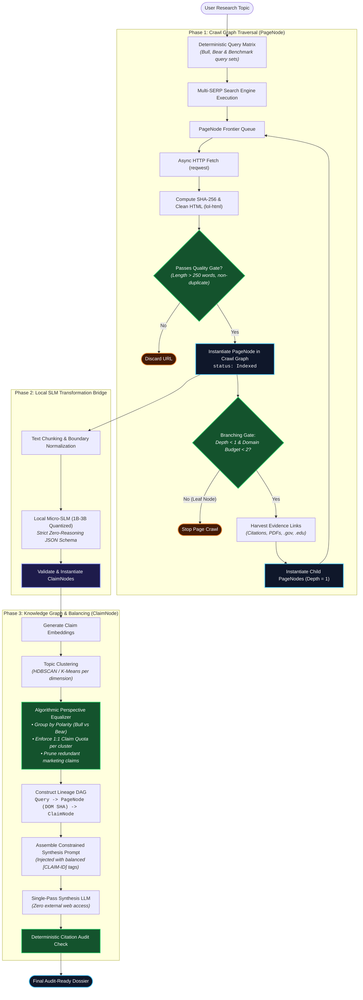

# Engine Architecture: Dual-Graph Research Engine

## 1. Node Representation Trade-Off Analysis & The Dual-Graph Paradigm

In this architecture, defining what constitutes a **Node** dictates how traversal algorithms operate, what data structures Rust allocates, and how perspective balancing is enforced.

There are four primary candidates for what a node can represent, along with a hybrid design that separates crawling from synthesis.

---

### Approach 1: Node = URL / Web Page (The Web Graph)

A node represents a single canonical URL. Edges represent directed hyperlinks pointing from one page to another.

* **How Traversal Works:** Standard BFS/DFS. A node is added to the frontier queue when a link is parsed from an HTML anchor tag (`<a href="...">`).
* **Pros:**
  * **Extremely Fast & Memory Efficient in Rust:** A node is essentially a `struct PageNode { id: Uuid, url: Url, domain: String, depth: usize, raw_text: String }`. Storing and hashing URLs requires negligible memory and zero LLM intervention.
  * **Natural Domain Rate Limiting:** Enforcing domain ceilings (e.g., max 2 nodes per root domain) is a trivial hash map lookup: `domain_counts.get(&domain) < MAX_PER_DOMAIN`.
* **Cons:**
  * **Too Coarse for Bias Balancing:** A single page often contains multiple viewpoints, tangential noise, or sponsored paragraphs. You cannot balance perspectives at the page level because a page is not a discrete semantic unit.
  * **Link Spam Trap:** Following raw hyperlinks via DFS frequently leads to navigation footers, terms of service, and unrelated cross-promotional blogs without an understanding of link context.

---

### Approach 2: Node = Cleaned Text Chunk / Passage

A node represents a bounded block of text (e.g., 200–500 words or a single coherent semantic section) extracted from an article after HTML stripping.

* **How Traversal Works:** The graph connects chunks within the same document sequentially, while cross-document edges are built using local BM25 score overlap or lexical similarity.
* **Pros:**
  * **Zero LLM Overhead:** Chunks are created purely with algorithmic token/character splitters or regex paragraph boundaries.
  * **Better Noise Filtering:** Irrelevant chunks (e.g., author bios, copyright notices) are dropped via BM25 thresholding without needing to discard the entire parent webpage.
* **Cons:**
  * **Boundary Fragmentation:** Context gets sliced awkwardly across chunks (a premise might be in chunk $A$ while its critical counter-argument is in chunk $B$).
  * **Graph Density Explosion:** A single crawled site produces dozens of chunk nodes. Calculating edges between every chunk without an expensive embedding matrix scales quadratically ($O(N^2)$).

---

### Approach 3: Node = Atomic Claim / Factual Assertion

A node represents a single extracted assertion derived by the local micro-SLM (e.g., `"Solid-state batteries degrade 30% slower than NMC cells under high thermal stress"`), tagged with its source URL and evidence.

* **How Traversal / Structure Works:** Edges represent logical polarity (Supports, Contradicts, Relates To) computed by embedding cosine distance or clustering.
* **Pros:**
  * **Ideal for Bias Balancing:** Because assertions are isolated, running K-Means or polarity clustering on claim embeddings allows you to mathematically enforce a 1:1 ratio between opposing viewpoints in the final prompt context window.
  * **Maximum Token Efficiency:** Strips 95% of narrative filler before sending data to the final summarizer LLM.
  * **Unambiguous Citations:** Every single assertion directly tracks back to the exact URL and quote that spawned it.
* **Cons:**
  * **Cannot Be Used During the Crawl:** Claims only exist *after* pages are fetched and parsed through a micro-SLM. You cannot use claim nodes to navigate or traverse the web.
  * **Risk of Extraction Error:** If the 1B–3B parameter micro-SLM misunderstands a nuance, that error becomes baked into the claim node.

---

### Approach 4: Node = Entity / Concept (Traditional Knowledge Graph)

A node represents a named entity or technical concept (e.g., `"Lithium Iron Phosphate"`, `"Thermal Runaway"`), while edges represent relationships (e.g., `CAUSES`, `INHIBITS`, `COMPETES_WITH`).

* **How Traversal Works:** Path traversal follows relationship predicates across entities.
* **Pros:**
  * **Strong Structural Reasoning:** Excellent for uncovering multi-hop connections (e.g., Entity $A \to$ Entity $B \to$ Entity $C$).
  * **High Explainability:** Easy to visualize as an interactive ontology or topology map.
* **Cons:**
  * **Heavy Compute Penalty:** Accurate entity and relation extraction from raw text usually requires larger reasoning models; running this on 1B–3B local SLMs often results in hallucinated or inconsistent entity schemas.
  * **Poor Representation of Nuance:** Complex arguments and policy debates cannot easily be reduced to simple `(Subject, Predicate, Object)` triplets without losing critical qualifiers.

---

### The Recommended Architecture: The Dual-Graph Approach

Attempting to force a single node definition across both the discovery phase and the balancing phase creates conflicting constraints. The cleanest system design splits the pipeline into two decoupled graph representations:

```
[ Crawl Graph ]                          [ Knowledge Graph ]
Node: URL / Page                         Node: Atomic Claim
Edge: Hyperlink / Domain Hierarchy  ──►  Edge: Semantic Distance / Polarity
Operates on: Network & DOM I/O           Operates on: Synthesized Facts
```

1. **Traversal Engine (Phase 2):** Uses **Page Nodes** (`Node = URL`). Traversal is purely deterministic, fast, and enforces domain ceilings at zero token cost.
2. **Balancing & Synthesis Engine (Phases 4–5):** Converts the scraped text into **Claim Nodes** (`Node = Extracted JSON Claim`). The equalizer clusters these claim nodes, balances the ratios mathematically, and hands them off to the final LLM.

---

## 2. High-Level Architecture

```mermaid
flowchart LR
    subgraph G1 ["1. Crawl Graph (Page Level)"]
        direction TB
        Q["User Research Query"] --> EXP["Deterministic Matrix Expansion<br/><i>(Polarity & Domain Dimensions)</i>"]
        EXP --> CRAWL["BFS Crawl & Selective Citation DFS<br/><i>(Hard Domain Quotas, Zero LLM)</i>"]
        CRAWL --> DOM_AUDIT[("Raw DOM Archive<br/><i>SHA-256 Stamped</i>")]
    end

    subgraph Bridge ["Transformation Bridge"]
        direction TB
        DOM_AUDIT --> CLEAN["Boilerplate & Noise Filter<br/><i>(lol-html / MinHash)</i>"]
        CLEAN --> EXTRACT["Local Micro-SLM (1B-3B)<br/><i>(JSON Schema Extraction)</i>"]
    end

    subgraph G2 ["2. Knowledge Graph (Claim Level)"]
        direction TB
        EXTRACT --> CLAIMS["Atomic Claim Nodes<br/><i>(Subject, Predicate, Polarity)</i>"]
        CLAIMS --> CLUSTER["Semantic Clustering & 50/50 Equalizer<br/><i>(Enforce Balanced Quotas)</i>"]
        CLUSTER --> SYNTH["Single-Pass Synthesis<br/><i>(Audit-Linked Report)</i>"]
    end

    G1 --> Bridge --> G2
```



---

## 3. Node Specifications & Rust Data Structures

### Graph 1: The Crawl Graph (`PageNode`)
Operates on URLs and DOM trees. Rust allocates lightweight nodes with zero LLM overhead during ingestion.

```rust
use uuid::Uuid;
use url::Url;

#[derive(Debug, Clone, PartialEq, Eq)]
pub enum CrawlStatus {
    Queued,
    Fetching,
    Parsed,
    FilteredOut(String), // e.g., "Domain quota reached", "Thin content"
    Indexed,
}

#[derive(Debug, Clone)]
pub struct PageNode {
    pub id: Uuid,
    pub url: Url,
    pub domain: String,
    pub depth: usize,              // Root SERP = 0, Citation hop = 1
    pub parent_id: Option<Uuid>,   // Provenance trail
    pub raw_dom_hash: String,      // SHA-256 for audit immutability
    pub clean_text: Option<String>,
    pub status: CrawlStatus,
}
```

* **Traversal Rules:**
  * **Strict Depth Ceiling ($D \le 1$):** SERP hits are Depth 0. Primary citations/evidence links are Depth 1. Depth 1 nodes cannot spawn children (hard leaf nodes).
  * **Domain Ceiling ($N \le 2$):** Maximum 2 pages per root domain to prevent SEO blog monopolies.
  * **Link Classification:** Follows only outbound evidence anchors (e.g., links with anchors containing *"study"*, *"filing"*, *"source"*, or pointing to `.gov`, `.edu`, ArXiv, or PDF files). Drops navigation, footers, and social share links.

---

### Graph 2: The Knowledge Graph (`ClaimNode`)
Operates on extracted factual propositions. Created strictly after DOM ingestion by a local 1B–3B micro-SLM.

```rust
use uuid::Uuid;

#[derive(Debug, Clone, PartialEq, Eq)]
pub enum Polarity {
    Bull,           // Affirmation, growth, competitive advantage
    Bear,           // Criticism, technical failure, regulatory risk, lawsuit
    NeutralMetric,  // Empirical benchmark, raw specification, financial audit
}

#[derive(Debug, Clone)]
pub struct ClaimNode {
    pub id: Uuid,
    pub source_page_id: Uuid,      // Foreign key linking directly to PageNode.id
    pub subject: String,          // e.g., "Solid-State Battery"
    pub statement: String,        // e.g., "Retains 80% capacity after 1,000 cycles at 25C"
    pub polarity: Polarity,
    pub confidence: f32,          // Extraction confidence (0.0 - 1.0)
    pub embedding: Vec<f32>,      // Vector for clustering & duplicate detection
    pub cluster_id: Option<usize>,// Analytical dimension (e.g., "Unit Economics", "Safety")
    pub is_selected: bool,        // Flagged true if picked by the 50/50 Equalizer
}
```

* **Balancing Rules:**
  * **Dimensional Clustering:** Claim embeddings are grouped by analytical topic (e.g., *Thermal Stability*, *Manufacturing Cost*, *Litigation*).
  * **50/50 Perspective Equalizer:** Within each cluster, the engine prunes overrepresented promotional claims to match counter-theses 1:1, or flags structural information asymmetry.

---

## 4. End-to-End Pipeline & Decision Logic



---

## 5. Audit Traceability Guarantee

Every claim in the final dossier preserves an unbroken, deterministic audit trail back to the exact DOM snapshot:

$$\text{User Topic} \longrightarrow \text{Query Strategy} \longrightarrow \text{PageNode (URL + SHA-256)} \longrightarrow \text{ClaimNode (UUID)} \longrightarrow \text{Equalizer Cluster} \longrightarrow \text{Dossier Citation}$$

* If a cited claim is challenged, counsel or auditors can inspect the immutable SHA-256 DOM snapshot recorded in the Crawl Graph at the moment of ingestion.
