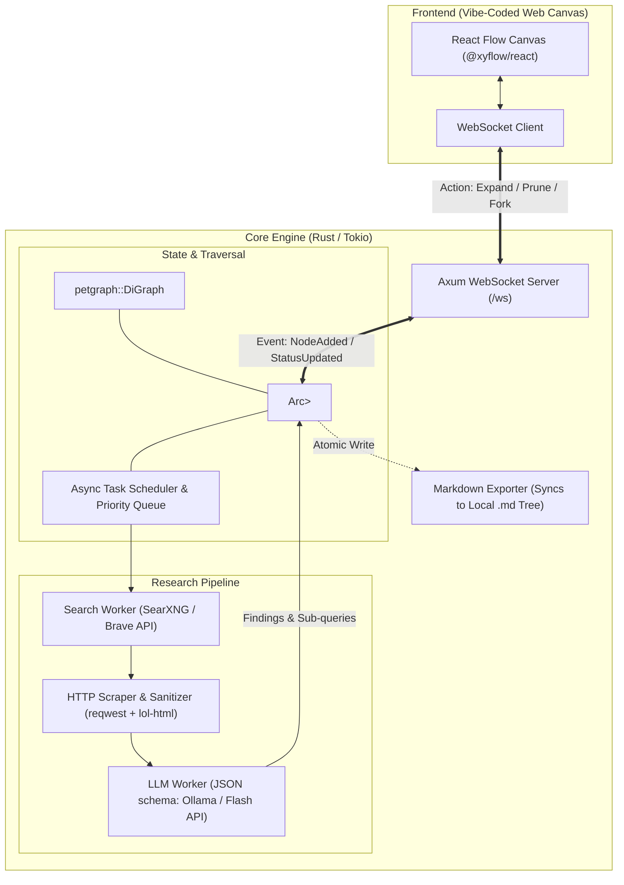
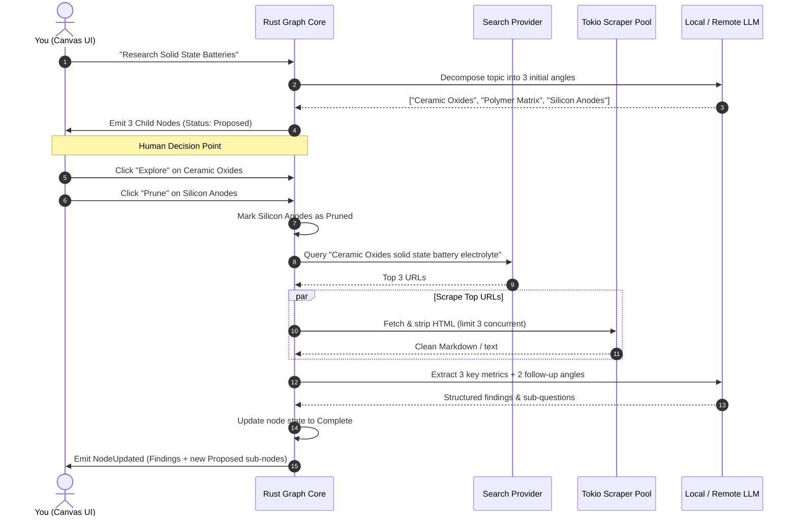

# DumbDeepResearch
This is the complete architectural specification and build plan for **Dumb Deep Research** (an interactive, tree-of-thought human-in-the-loop research engine).

The boundary is drawn strictly: **you build the Rust core engine** (graph state machine, async scraping queue, and LLM orchestration), while the web canvas frontend and API glue are kept minimal so they can be generated ("vibe-coded") in an afternoon using React Flow (`@xyflow/react`) and Vite.

---

# Dumb Deep Research: Interactive Tree-of-Thought Research Engine



---

## 1. Division of Labor

| Component | Owner | Stack | What It Does |
| --- | --- | --- | --- |
| **Graph State Machine** | **You (Rust)** | `petgraph`, `tokio`, `Arc<RwLock>` | Thread-safe Directed Acyclic Graph (DAG) tracking research nodes, depths, parent-child links, and execution states. |
| **Scraping & Ingestion** | **You (Rust)** | `reqwest`, `lol-html`, `tokio::sync::Semaphore` | Bounded concurrent fetching, HTML boiler-plate stripping down to raw text without memory bloat. |
| **LLM Orchestrator** | **You (Rust)** | `reqwest` / Ollama / OpenAI-compatible API | Strict JSON-schema prompts for deconstructing topics, scoring relevance, and extracting 3 key facts. |
| **Canvas UI & Node Cards** | **Vibe-Code (Prompt AI)** | React, `@xyflow/react`, Tailwind, Lucide | Infinite pan/zoom canvas displaying nodes as Markdown cards with Expand (`+`), Prune (`x`), and Deep Dive buttons. |
| **WebSocket Sync Bridge** | **Vibe-Code (Prompt AI)** | `axum` (WS upgrade) + browser WebSocket | Fans out JSON events (`NodeAdded`, `NodeUpdated`, `NodePruned`) to keep UI in lockstep with the engine. |

---

## 2. Core Data Structures (Rust Engine)

```rust
use serde::{Deserialize, Serialize};
use uuid::Uuid;

#[derive(Debug, Clone, Serialize, Deserialize, PartialEq, Eq)]
pub enum NodeStatus {
    Proposed,    // Generated as a sub-topic; waiting for user action
    Queued,      // User clicked "Explore"; sitting in Tokio queue
    Searching,   // Fetching SERP results
    Scraping,    // Pulling web pages
    Synthesizing,// Running LLM extraction
    Complete,    // Findings populated
    Pruned,      // User killed this branch
    Failed(String),
}

#[derive(Debug, Clone, Serialize, Deserialize)]
pub struct SourceRef {
    pub url: String,
    pub title: String,
    pub snippet: String,
}

#[derive(Debug, Clone, Serialize, Deserialize)]
pub struct ResearchNode {
    pub id: Uuid,
    pub parent_id: Option<Uuid>,
    pub depth: usize,
    pub topic: String,
    pub query: String,
    pub status: NodeStatus,
    pub findings: Vec<String>,       // 3 atomic bullet points
    pub suggested_branches: Vec<String>, // Potential child questions
    pub sources: Vec<SourceRef>,
}

```

---

## 3. WebSocket Event Protocol (Engine ⟷ Canvas)

Communication between the Rust backend and the React canvas runs over standard JSON frames:

### Frontend ➔ Engine (Actions)

* **`StartResearch`**: `{ "type": "START", "topic": "Solid State Batteries" }`
* **`ExploreBranch`**: `{ "type": "EXPLORE", "node_id": "uuid", "custom_prompt": null }`
* **`PruneBranch`**: `{ "type": "PRUNE", "node_id": "uuid" }`
* **`SynthesizePath`**: `{ "type": "SYNTHESIZE", "node_ids": ["uuid-1", "uuid-2"] }`

### Engine ➔ Frontend (Delta Broadcasts)

* **`NodeAdded`**:
```json
{
  "type": "NODE_ADDED",
  "node": {
    "id": "c7a8b412-...",
    "parent_id": "00000000-...",
    "depth": 1,
    "topic": "Ceramic vs Polymer Electrolytes",
    "status": "Proposed",
    "findings": [],
    "suggested_branches": []
  }
}

```


* **`NodeUpdated`**:
```json
{
  "type": "NODE_UPDATED",
  "node_id": "c7a8b412-...",
  "status": "Complete",
  "findings": [
    "LLZO ceramics achieve conductivities exceeding 1 mS/cm at room temp.",
    "Polymer matrices require operating temps above 60°C to match ionic transport.",
    "Dendrite penetration remains problematic at high current densities."
  ],
  "suggested_branches": [
    "What are the sintering temperatures of LLZO?",
    "Which commercial manufacturers use composite polymer-ceramic blends?"
  ],
  "sources": [{ "url": "https://...", "title": "...", "snippet": "..." }]
}

```


---

## 4. Pipeline Execution Lifecycle



---

## 5. Step-by-Step Implementation Plan

### Phase 1: Rust Engine Core (Your Build)

1. **Initialize Project:**
```bash
cargo new Dumb Deep Research-engine --bin
cargo add tokio axum petgraph serde serde_json uuid reqwest lol-html thiserror tracing tracing-subscriber

```


2. **Graph Manager (`src/graph.rs`):**
* Wrap `petgraph::graph::DiGraph<ResearchNode, ()>` inside an `Arc<RwLock<...>>`.
* Implement methods: `add_root()`, `add_child()`, `set_status()`, `update_findings()`, and `prune_subtree()`.


3. **Scraper & Ingestion (`src/scraper.rs`):**
* Setup a `reqwest::Client` with a realistic User-Agent and a 10s timeout.
* Use `lol-html` or basic regex/heuristics to strip `<script>`, `<style>`, `<nav>`, and `<footer>` tags, outputting plain UTF-8 text slices.
* Bound concurrent downloads with `tokio::sync::Semaphore::new(4)`.


4. **LLM Connector (`src/llm.rs`):**
* Write a typed caller to either `localhost:11434/api/generate` (Ollama) or any OpenAI-compatible `/v1/chat/completions` endpoint.
* Enforce output formatting via prompts: `"Return strictly a JSON object matching { findings: string[], next_questions: string[] }"`.


5. **WebSocket Dispatcher (`src/ws.rs`):**
* Expose an Axum route `GET /ws` that upgrades connections, listens for incoming JSON actions, and broadcasts engine state deltas via a `tokio::sync::broadcast` channel.


### Phase 2: Frontend Vibe-Coding (AI-Generated UI)

Use the following exact prompt with an LLM code assistant (Claude 3.7 / Cursor / v0) to scaffold the frontend without writing boilerplate by hand:

> *"Build a single-page React app with Vite, Tailwind CSS, and `@xyflow/react` (React Flow) that acts as an interactive AI research canvas.*
> *Requirements:*
> 1. *Connect to `ws://localhost:3000/ws`.*
> 2. *Render incoming `NODE_ADDED` events as custom React Flow cards. Each card must show: Topic title, Status badge (Proposed, Loading, Complete), Findings as bullet points, and Suggested follow-up chips.*
> 3. *Add two buttons to each card: an 'Explore' button that sends `{ type: 'EXPLORE', node_id }` over WebSocket, and a 'Prune' button that sends `{ type: 'PRUNE', node_id }`.*
> 4. *Use `@xyflow/react` dagre or elkjs auto-layout so nodes automatically position themselves in a clean left-to-right or top-to-bottom tree as new nodes arrive.*
> 5. *Include a top navigation bar with a search input to submit the initial research goal (`{ type: 'START', topic }`)."*
> 
> 

---

## 6. Recommended Crates for the Engine

```toml
[dependencies]
# Async Runtime & Networking
tokio = { version = "1.40", features = ["full"] }
axum = { version = "0.8", features = ["ws"] }
reqwest = { version = "0.12", features = ["json", "gzip", "brotli"] }

# Graph & State
petgraph = { version = "0.6", features = ["serde-1"] }
uuid = { version = "1.10", features = ["v4", "serde"] }
serde = { version = "1.0", features = ["derive"] }
serde_json = "1.0"

# HTML Parsing & Sanitization
lol-html = "2.1"

# Observability
tracing = "0.1"
tracing-subscriber = "0.3"

```

This setup keeps your coding focused purely on high-performance backend systems in Rust—handling network streams, concurrency, and graph state—while giving you an intuitive, visual decision-tree interface on the web.
