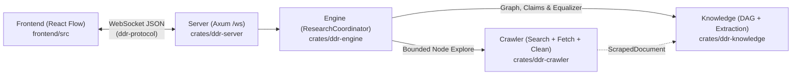
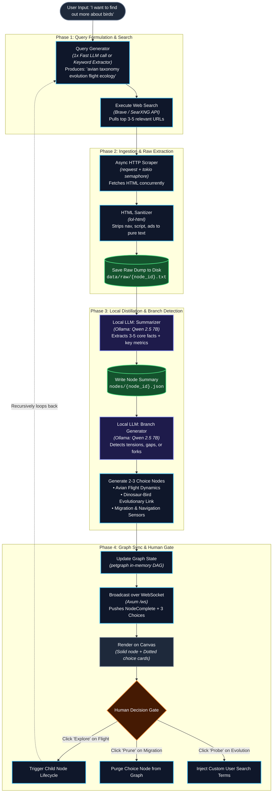

# DumbDeepResearch (DDR)

DumbDeepResearch (DDR) is a deterministic, visual, human-in-the-loop research engine. Instead of letting an autonomous AI agent spend 10 minutes burning tokens in a black box, DDR gives you a live visual map of how the research is unfolding—branch by branch, source by source, with a human deciding where to go next.

---

## The Core Concept

* **"Dumb" by Design:** The LLM does not make autonomous routing decisions or wander off. It is used strictly as a fast utility to break topics into sub-queries and pull 3 bulleted facts out of scraped pages.
* **Deterministic Flow:** You control the graph, the traversal, the search queries, and the depth limits.
* **Live Visual Canvas:** Instead of waiting for one giant markdown report at the end, research results appear as cards on an interactive node graph (similar to an Obsidian canvas) as they happen.
* **You Steer the Direction:**
* **Explore (`+`):** Approve an interesting sub-topic to dig deeper.
* **Prune (`x`):** Kill irrelevant branches instantly so no more time or tokens are wasted on them.
* **Manual Probe:** Click any node to inject your own custom search query or prompt instructions instead of accepting the AI's default.
* **Depth & Breadth Limits:** Set exact boundaries on how many levels deep a search can go and how many pages to scrape.

---

## Architecture Overview

---

## System Division

### 1. The Core Engine (What You Build in Rust)

* **Graph State Machine:** In-memory DAG (`petgraph` + `tokio`) tracking node relationships, execution states, and depth.
* **Scheduler & Limits:** Enforces depth caps, max concurrent requests, and instant task cancellation when branches are pruned.
* **Fast Scraping Pipeline:** Async HTTP client (`reqwest`) and streaming HTML sanitizer (`lol-html`) to strip clutter down to clean text with low RAM usage.
* **LLM Calls:** Simple, rigid JSON-schema calls to local Ollama or a fast API (e.g., Flash) strictly for query generation and fact extraction.
* **WebSocket Bridge:** An `axum` WebSocket route streaming graph changes (`NodeAdded`, `NodeUpdated`, `NodePruned`) directly to the frontend.

### 2. The Visual Canvas (Vibe-Coded with AI)

* **Stack:** Single-page React app using Vite, Tailwind CSS, and `@xyflow/react` (React Flow).
* **Interface:**
* Infinite pan/zoom canvas.
* Node cards showing topic title, live status (Queued, Scraping, Complete), 3 key findings, and source links.
* Card controls: **Explore**, **Prune**, and **Probe** (opens an input to override the search query).
* Top bar: Root research input, global depth slider, and max-source settings.

---

## Solidified Protocol & Data Model

### Node Data Structure

* `id`: Unique identifier (UUID)
* `parent_id`: Parent node reference
* `depth`: Current level in the tree
* `topic`: Short display title
* `query`: Search string used
* `status`: `Proposed` | `Queued` | `Searching` | `Scraping` | `Complete` | `Pruned`
* `findings`: Array of 3 atomic factual bullet points
* `suggested_branches`: 2–3 follow-up angles generated by the model
* `sources`: List of URLs, titles, and snippets

### WebSocket Messages

* **Frontend Actions:**
* `START`: `{ topic, max_depth, max_sources }`
* `EXPLORE`: `{ node_id }`
* `PROBE`: `{ node_id, custom_query, prompt_override }`
* `PRUNE`: `{ node_id }`

* **Engine Broadcasts:**
* `NODE_ADDED`: Pushes a newly proposed or discovered node to the canvas.
* `NODE_UPDATED`: Streams status changes, findings, and verified sources to an existing card.

---

## System Flow Diagram

